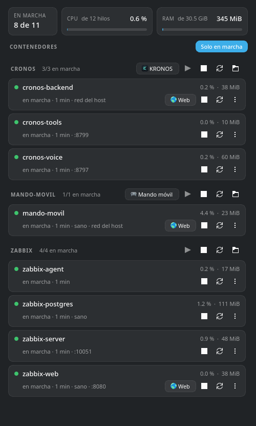

# ZenDock

Los contenedores Docker del portátil, con la misma pinta que
[ZenMonitor](https://github.com/PandaAkiraNakai/zenmonitor): estado, salud y consumo de
cada contenedor, agrupados por proyecto de compose, y los botones de siempre para
**encenderlos, apagarlos, reiniciarlos, abrir su web o lanzar la app que los acompaña**.

Está escrito en Rust y partido en dos procesos:

- **`zendock --tray`**, el icono de la bandeja: un demonio sin toolkit gráfico (unos
  10 MB de RAM) que no gasta CPU mientras no pasa nada. No consulta Docker cada pocos
  segundos: lee la lista una vez y luego escucha el flujo de eventos.
- **`zendock`**, la ventana: un proceso aparte que solo existe mientras está abierta.
  Al cerrarla termina y devuelve toda su memoria.

Y respeta la **activación por socket** de Docker: con Docker apagado no toca su socket
(conectarse lo encendería) y te ofrece encenderlo.



## Qué muestra

| Zona | Datos |
|---|---|
| **Resumen** | Contenedores en marcha, CPU y RAM que suman entre todos |
| **Proyecto** | Nombre, cuántos están en marcha, apps de escritorio asociadas y acciones de conjunto |
| **Contenedor** | Punto de estado, tiempo en marcha o desde que se paró, salud, puertos, CPU y RAM |

El punto de color resume el estado:

| Color | Significa |
|---|---|
| Verde | En marcha (y sano, si tiene healthcheck) |
| Ámbar | Arrancando, no sano, en pausa o con una acción en curso |
| Rojo | Reiniciándose en bucle, muerto, sin memoria o parado con un código de error |
| Gris | Parado normalmente (código 0, o 137/143 de un `docker stop`) |

El tooltip de cada tarjeta tiene el resto: imagen, ID, servicio de compose, puertos con
su IP, IPs en cada red y política de reinicio con su contador.

## Qué hace

- **Encender, apagar y reiniciar** cada contenedor, o el **proyecto entero** desde su
  cabecera. Las acciones de proyecto usan `docker compose start/stop/restart` con los
  ficheros del propio proyecto, así que respetan `depends_on`. Si esos ficheros ya no
  existen, se hace contenedor a contenedor por la API.
- **Web**: botón que abre en el navegador la web que sirve el contenedor. Si tiene
  varias, despliega un menú.
- **App**: botón que lanza la aplicación de escritorio asociada al proyecto (por
  ejemplo KRONOS para `cronos`).
- **Menú ⋯**: ver logs en vivo (`docker logs -f` en un terminal), abrir una shell
  dentro, pausar/reanudar, copiar la IP o el nombre y abrir la carpeta del proyecto.
- **Avisos**: una notificación si un contenedor se cae con un código de error, se queda
  sin memoria o su healthcheck empieza a fallar. Un `docker stop` o un apagado desde la
  propia app no avisan. Se desactiva desde el menú de la bandeja.
- **Solo en marcha**: esconde los contenedores y proyectos parados.
- **Encender Docker**: con Docker apagado, la bandeja y la ventana lo dicen y ofrecen
  encenderlo.

## Docker con activación por socket

Si usas `docker.socket` (Docker apagado hasta que algo use su socket), cualquier
conexión a `/var/run/docker.sock` lo enciende. Por eso ZenDock **nunca abre el socket si
dockerd no está en marcha**, y para saberlo no lo toca:

1. Le pregunta a systemd por D-Bus el `ActiveState` de `docker.service` y se suscribe a
   sus cambios (`PropertiesChanged`): se entera al instante de que Docker arranca o se
   para, sin sondear. Solo se conecta con el estado en `active`; durante un apagado
   (`deactivating`) espera, aunque dockerd tarde en terminar.
2. Sin systemd o sin esa unidad, mira cada 3 s el fichero de PID de dockerd
   (`/run/docker.pid`) y comprueba que ese PID siga vivo y sea dockerd.

Con Docker apagado el icono se pone gris, el tooltip dice "Docker apagado" y el menú
trae **Encender Docker**, que hace un `GET /_ping` al socket: eso es lo que lo arranca
por activación. No hay "Apagar Docker": parar un servicio del sistema pide permisos
que una app de usuario no debería tener.

Con Docker sin root (`DOCKER_HOST=unix://$XDG_RUNTIME_DIR/docker.sock`) se usa la
unidad de usuario `docker.service` de la misma forma.

## Cómo encuentra las webs

Nada que configurar en el caso normal:

1. A cada **puerto TCP publicado** se le hace un `GET /` (por http y por https, sin
   validar el certificado). Cuenta como web si responde HTML o una redirección. Una API
   que contesta JSON no cuenta, y a los puertos de protocolos que no son HTTP (SSH,
   PostgreSQL, MySQL, Redis, Zabbix…) ni se les pregunta.
2. Un contenedor con **red del host** no publica puertos, así que se prueban los que
   declara su imagen (`EXPOSE`), **salvo los que ya publica otro contenedor**. Hace falta
   la excepción: `cronos-backend` declara el 8080 pero escucha en el 8765, y el 8080 del
   host es el de Zabbix.
3. Si el puerto no contesta todavía (Apache tarda un segundo en abrirlo al arrancar), se
   vuelve a probar cada 3 s durante los dos primeros minutos y luego cada minuto. Un
   "esto no es una web" sí es definitivo hasta que el contenedor se reinicie.

Lo que no se puede adivinar se fija a mano. Una web explícita sustituye a las
detectadas:

- Con una **etiqueta** en el `docker-compose.yml`:

  ```yaml
  labels:
    zendock.web: "Panel=http://localhost:8765, API=http://localhost:8765/docs"
    zendock.app: "cronos.desktop"
  ```

- O en **`~/.config/zendock/enlaces.json`**, sin tocar el proyecto. La clave es el nombre
  del contenedor para `web` y el del proyecto (o del contenedor suelto) para `app`:

  ```json
  {
    "cronos-backend": {"web": ["Cronos=http://127.0.0.1:8765"]},
    "mando-movil": {"web": ["QR para el móvil=http://localhost:8777/conectar"]}
  }
  ```

  El fichero se relee solo al guardarlo. Si tiene un error de sintaxis, la ventana lo
  dice abajo.

## Cómo encuentra las apps

Recorre los `.desktop` de `~/.local/share/applications`, `/usr/local/share/applications`
y `/usr/share/applications` y asocia una app a un proyecto si:

- el fichero se llama como el proyecto (`cronos.desktop` ↔ proyecto `cronos`), o
- su ejecutable, siguiendo enlaces simbólicos, vive dentro de la carpeta del proyecto
  (`~/.local/bin/mando-movil` → `~/docker/mando-movil/mando-movil`), o
- es un script de tu `$HOME` que menciona la carpeta del proyecto.

Con `zendock.app` o la clave `app` de `enlaces.json` se elige a mano. Las apps se lanzan
con `gtk-launch`, igual que desde el menú.

## Requisitos

- **Para compilar**: Rust y cargo (`pacman -S rust` en Arch, o [rustup](https://rustup.rs)).
- **Acceso al socket de Docker**: estar en el grupo `docker`
  (`sudo usermod -aG docker "$USER"` y volver a iniciar sesión). Respeta `DOCKER_HOST`
  si apunta a un socket `unix://`.
- Una bandeja con **StatusNotifierItem** (KDE Plasma, Noctalia, Waybar, …) y un servidor
  de notificaciones.
- El plugin `docker compose` para las acciones de proyecto.
- Un terminal para logs y shell: Konsole o kitty (si no, prueba con
  `x-terminal-emulator`, `kgx`, `gnome-terminal` o `xterm`).
- `wl-copy` (o `xclip`/`xsel` en X11) para copiar la IP o el nombre, y `fc-match`
  (fontconfig) para usar la fuente del sistema en la ventana.

## Instalación

```sh
git clone https://github.com/PandaAkiraNakai/zendock.git
cd zendock
./install.sh
```

Compila el binario y deja todo en `~/.local`, sin root: `~/.local/bin/zendock`, la
entrada del menú en `~/.local/share/applications/zendock.desktop` y el icono (dibujado
por el propio binario) en `~/.local/share/zendock/`. En KDE añade además una regla de
ventana para que volver a abrirlo traiga la ventana al frente. Opciones:

```sh
./install.sh --autostart     # arranca con la sesión, en segundo plano (solo bandeja)
./install.sh --sin-compilar  # usa el binario ya compilado en rust/target/release/
```

En Hyprland, el autoarranque se pone en su configuración:

```lua
-- configuración en Lua
hl.exec_cmd(os.getenv("HOME") .. "/.local/bin/zendock --tray")
```

```ini
# configuración clásica (hyprland.conf)
exec-once = ~/.local/bin/zendock --tray
```

Para quitarlo: `./uninstall.sh` (no borra `~/.config/zendock`).

## Uso

- Clic en el icono de la bandeja: abre la ventana, o la trae al frente si ya está
  abierta.
- Clic derecho: cada proyecto con encender/apagar/reiniciar todo, sus apps y sus webs.
- El icono se pone azul si hay algo en marcha, ámbar si algo va mal o hay una acción en
  curso, y gris si no hay nada encendido o Docker está apagado. El tooltip lista lo que
  va mal.
- Cerrar la ventana termina su proceso; la bandeja sigue.
- `zendock --tray` arranca solo la bandeja y es de **instancia única**, igual que la
  ventana: lanzar `zendock` con la ventana ya abierta la enfoca (en Hyprland, con
  `hyprctl`).

## Cómo lee los datos

No lanza un `docker` por cada lectura: habla directamente con la API HTTP del Engine por
`/var/run/docker.sock`, con un cliente HTTP/1.1 mínimo propio.

| Dato | Fuente |
|---|---|
| Lista y estado | `GET /containers/json?all=1` + `GET /containers/{id}/json`, una vez al conectar |
| Cambios al instante y avisos | Flujo `GET /events`, filtrado en el propio Docker a contenedores y a los eventos que importan; cada evento reinspecciona solo ese contenedor |
| CPU | `cpu_stats` de `GET /containers/{id}/stats?one-shot=true`, dos lecturas seguidas, como `docker stats` (100 % = un núcleo). **Solo con la ventana abierta**, cada 2 s |
| RAM | `memory_stats.usage` menos `inactive_file`, como `docker stats`. Igual: solo con la ventana abierta |
| Encender, apagar, reiniciar, pausar | `POST /containers/{id}/start\|stop\|restart\|pause\|unpause` |
| Acciones de proyecto | `docker compose -p … --project-directory … -f … start\|stop\|restart` |
| ¿Docker en marcha? | `ActiveState` de `docker.service` por D-Bus (o `/run/docker.pid`), nunca el socket |

Los eventos `exec_*` que generan los healthchecks ni siquiera llegan: el filtro del
flujo los descarta en Docker, así que no despiertan a ZenDock.

## Por qué pesa tan poco

- La bandeja no carga ningún toolkit: el icono y el menú van por D-Bus
  (StatusNotifierItem y DBusMenu, con [ksni](https://crates.io/crates/ksni)) y el icono
  se dibuja a mano.
- La ventana es [egui](https://crates.io/crates/egui) pintado **en la CPU** (winit +
  softbuffer, memoria compartida de Wayland): no carga OpenGL, cuyo driver (en Mesa,
  libLLVM y libgallium) ocupa por sí solo más de 50 MB por proceso. Como solo se repinta
  cuando cambia algo o llegan los stats, pintar en la CPU sobra.

Medido frente a la versión anterior en Python y PyQt6, en la misma máquina y con los mismos contenedores:

| | Python (PyQt6) | Rust |
|---|---|---|
| Bandeja en reposo, RAM (RSS) | 109 MB | 11 MB |
| Bandeja en reposo, CPU | 0,35 % (sondeo cada 2 s) | 0 % (solo eventos) |
| Ventana abierta de 500×830, RAM (RSS) | 87 MB | 22 MB |
| Ventana abierta de 500×830, CPU | 0,77 % | 0,23 % |
| Ventana cerrada | sigue en memoria (oculta) | el proceso termina |

## Variables de entorno

| Variable | Para qué |
|---|---|
| `DOCKER_HOST` | Otro socket `unix://` (por ejemplo, Docker sin root) |
| `ZENDOCK_CAPTURA=fichero.png` | La ventana guarda un fotograma a los 4 s y se cierra (para documentar) |
| `ZENDOCK_PUNTERO=x,y[,clic]` | Puntero sintético a los 2 s, para capturar menús y tooltips |
| `ZENDOCK_PERF=1` | Tiempo de pintado de cada fotograma por la salida de error |

## Licencia

MIT. Ver [LICENSE](LICENSE).

<!-- profile-excerpt -->
**Gestor de contenedores Docker en la bandeja, en Rust**, con la misma pinta que ZenMonitor: estado, salud, puertos, **CPU y RAM** de cada contenedor agrupados por proyecto de **compose**; encender, apagar y reiniciar uno o el **proyecto entero** (respetando `depends_on`), logs en vivo y shell dentro. **Detecta solas las webs** (sondea los puertos publicados y distingue una página de una API JSON) y **las apps de escritorio** de cada proyecto, y avisa si un contenedor se cae. La bandeja es un demonio de ~10 MB **dirigido por eventos** que respeta la **activación por socket** de Docker; la ventana (egui pintado en la CPU) es un proceso aparte que solo vive mientras está abierta.
<!-- /profile-excerpt -->
